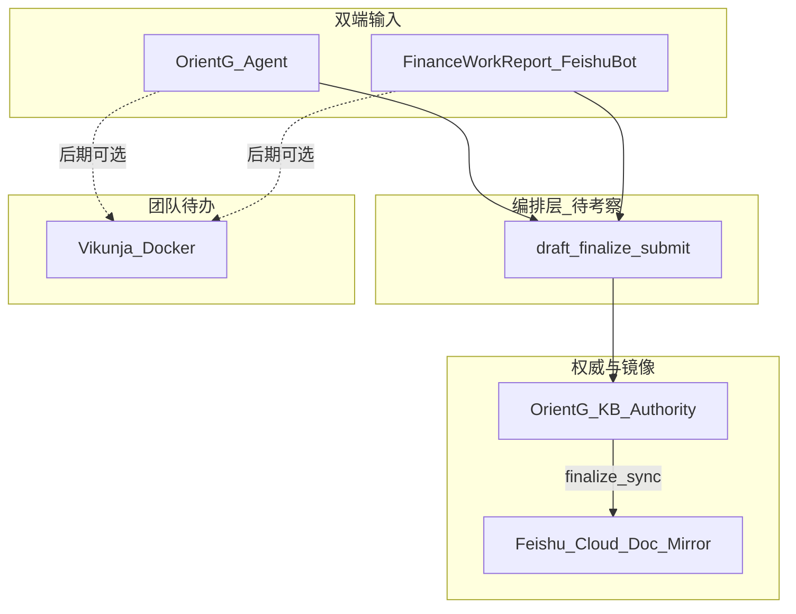

# 1.2.4 财务汇报与日程助理

| 字段 | 值 |
|------|-----|
| **status** | `draft`（规划已确认，待实施） |
| **版本前缀** | 1.2.4 |
| **实施计划** | [`specs/plans/1.2.4-财务汇报与日程助理-plan.md`](../plans/1.2.4-财务汇报与日程助理-plan.md) |
| **关联** | [1.2.3 Hermes 融合方案](1.2.3-Hermes-Agent与Orient-G融合方案.md)、[1.2.0.a 权限模型](1.2.0.a-权限模型与页面可见性.md)、[`docs/hermes.md`](../../docs/hermes.md) |

> **目标读者**：产品 / 技术负责人  
> **安全**：汇报权威存档在 Orient-G KB；飞书云文档为定稿镜像；团队待办数据优先落内网自托管；对话 LLM 为内网本地模型  
> **本期文档范围**：仅规制与计划落盘，不含业务代码实现  

---

## 1. 背景与问题

Orient-G 已提供财务信息汇总呈现、知识库 ACL、Hermes Agent（页面端对话 / MCP）。财务部门另需：

1. 用自然语言按**个人 / 部门**整理日、周、月报；
2. 部门周报（及月报）提交**管理层**（仓库角色 `管理层` / `ROLE_MANAGEMENT`）浏览；
3. 个人与团队待办互相布置与查看；
4. 入口与展示覆盖 **Orient-G 页面**与 **飞书（机器人 / 群聊 + 云文档）**。

公司日常沟通在企业微信，OKR 与部分办公在飞书。一期不把企微机器人、OKR 自动回写、管理层自然语言问答作为主路径。

### 1.1 仓库现状（避免混淆）

| 现有能力 | 是否等于本需求 |
|----------|----------------|
| Hermes + `/ai-interaction` 智能体 + KB MCP | 可复用为汇报对话与落库底座 |
| [`feishu_sync.py`](../../backend/services/feishu_sync.py) 流程文档 → 飞书 docx | 可扩展为汇报定稿镜像（需支持更新同一文档） |
| [`/utils/excel-kanban`](../../frontend/app/utils/excel-kanban/page.tsx) | **否**：Excel **数据可视化**看板，不是团队待办 |
| 飞书日历 Open API（共享日历 + ACL） | 可做团队**时间日程**，不足以单独承担看板态待办 |
| 管理层问答 RAG | **本版本不做**（见 §6） |

---

## 2. 目标与非目标

### 2.1 目标（产品）

1. **双端输入**：Orient-G 智能体对话 + **财务汇报专用**飞书机器人 / 群聊。
2. **双端展示**：Orient-G 知识库浏览 + 定稿后同步**飞书云文档**（书写人在飞书侧可立刻拿到文档链接）。
3. **汇报类型**：个人日报、个人周报、部门周报；部门月报模板预留。
4. **提交管理层**：部门周 / 月报定稿后可提交；KB 打开 `allow_management`（及既有管理层可读路径）；飞书镜像调整可见范围。
5. **团队待办**：内网 Docker 部署开源 **Vikunja**，满足互相布置、查看、团队项目 / 截止日期；与汇报链路解耦。
6. **多机器人预留**：财务汇报 bot 与未来其他飞书 bot 按 `bot_id → capability` 隔离路由。

### 2.2 非目标（明确不做或后延）

| 项 | 说明 |
|----|------|
| 管理层自然语言问答 | 暂缓：日周报粒度未定时难以保证问答体验 |
| 飞书日历深度集成 | 后延：共享日历可看日程，但不替代看板态待办；见 §5 |
| OKR 结果自动回写 | 非主目标；困难，不进本期验收 |
| 企业微信机器人 / 从企微抓聊天做素材 | 后延 |
| 草稿同步飞书云 | 禁止；仅 **定稿** 同步（策略 B） |
| 自研完整日历 / 看板替代 Vikunja | 一期不造轮子 |
| 用 excel-kanban 充当团队待办 | 禁止混用口径 |

---

## 3. 总体架构



**原则**

- 业务写路径统一走 Orient-G（MCP / 服务层）；飞书 bot 是通道，不另造第二套汇报逻辑。
- KB 为汇报**权威源**；飞书云文档为**定稿镜像**（给人在飞书阅读与及时反馈）。
- 团队待办权威源为一期的 **Vikunja**（内网）；不与汇报正文混存在飞书日历。

### 3.1 与 1.2.3 的关系

复用：Hermes Gateway、`/api/agent/chat[/stream]`、`orientg_kb_*` MCP、用户 JWT / `hermes_session_key`、角色 `管理层`、文件夹分享到管理层。

新增（实施阶段）：汇报编排（Skill 或 Workflow，见 §7）、`orientg_work_report_*` MCP、飞书 doc **更新**能力、财务汇报专用 bot 配置、Vikunja compose 与站内入口。

---

## 4. 汇报：数据、状态机与展示

### 4.1 文档类型

| `report_kind` | 书写者 | 默认可读 | 是否需 submit |
|---------------|--------|----------|---------------|
| `personal_daily` | 本人 | 本人（部门内可见策略可配置） | 否 |
| `personal_weekly` | 本人 | 本人 / 部门负责人 | 否（可被汇总进部门周报） |
| `dept_weekly` | 汇总人（部门 lead 或授权） | 部门（草稿 / 定稿） | **是** → 管理层可读 |
| `dept_monthly` | 同上 | 同上 | **是**（模板一期预留） |

正文以 KB 文档存储；元数据可用 frontmatter 或索引表字段，至少包含：

```text
report_kind, period, department_id, status,
submitted_at, submitted_by,
feishu_document_id, feishu_url, feishu_sync_status,
finalized_at
```

可选薄表 `work_report_index`（doc_id + 上列字段）便于列表筛选；正文仍在 KB。

### 4.2 状态机

```text
draft          → 仅 Orient-G；不同步飞书
finalized      → KB 定稿 + 创建或更新飞书云文档；对话回双端链接
submitted      → 仅 dept_weekly / dept_monthly：
                 KB allow_management（及约定文件夹）；
                 飞书镜像权限 / 目录调整为管理层可阅
```

**定稿同步策略 B（已确认）**

- 个人日 / 周报、部门周 / 月报：用户确认定稿时同步飞书。
- 草稿不同步。
- 再次定稿：更新**同一** `feishu_document_id`，不新建散落文档。

飞书同步失败时：KB 定稿仍可成功；`feishu_sync_status=failed`，提示重试；记审计。

### 4.3 展示分流（已确认）

| 角色 | 入口 | 行为 |
|------|------|------|
| 书写人 | Orient-G 智能体 / 财务汇报飞书机器人或群 | 对话生成、改稿、确认定稿；定稿后见 KB 文档与飞书链接 |
| 管理层 | Orient-G `/knowledge`（已提交材料）+ 飞书云文档 | **浏览呈现**；一期不做「问机器人答汇报」 |

### 4.4 提交流程（部门周 / 月报）

1. 汇总人确认 `dept_*` 已 `finalized`。
2. 调用提交能力：校验部门 lead / 授权角色。
3. `status=submitted`；KB ACL 打开管理层可读（复用现有 `allow_management` / ManagementPublic 分享机制）。
4. 调整对应飞书文档可见范围（镜像，非权威源切换）。
5. **不**把未定稿草稿推上飞书。

---

## 5. 团队待办与飞书日历裁定

### 5.1 需求

- 团队待办统一一处；
- 成员可互相布置与查看；
- 可布置团队日程 / 截止日期；
- 优先现成开源、Docker 本地部署。

### 5.2 能力对比（裁定依据）

| 能力 | 飞书共享日历 | 飞书任务 Task | Vikunja（自托管） |
|------|--------------|---------------|-------------------|
| 团队统一查看 | 共享日历 + ACL | 清单协作 | 项目共享 |
| 互相布置 | 日程 + 参与人（偏会议） | 负责人 / 关注人 | 指派 + 看板状态 |
| 看板 / 完成态 | 弱 | 中（飞书 App） | 强（List / Kanban / Gantt） |
| 数据主权 | 飞书云 | 飞书云 | 内网 Docker |

**裁定**

1. **团队待办主路径 = Vikunja**（AGPLv3、单容器可跑、Kanban、指派、项目共享、截止日期）。
2. **飞书日历深度集成 = 后延**（不进入 1.2.4.a–d 验收）。日历适合时间块与提醒，不能单独满足看板态待办。
3. 若未来要在飞书 App 内看「待办」而非仅日程，优先评估飞书 **任务 API**，而非日历 API。
4. Orient-G 侧：compose 增加 `vikunja`；实用工具或侧栏增加入口（外链或内嵌）；账号与 Orient-G 用户映射可二期。自然语言经 bot 建 Vikunja 任务列为更后阶段。

### 5.3 与 excel-kanban 的边界

`excel-kanban` 继续只服务「上传 Excel → 图表解读」。团队待办文案、入口、Skill 名称不得与之混用。

---

## 6. 管理层问答（暂缓）

**原因**：个人日周报写法与粒度未稳定前，KB RAG 问答易空转或幻觉，损害管理层信任。

**一期**：管理层仅浏览已提交（及约定可读）的 KB / 飞书镜像。

**解禁条件（未来）**：抽样真实汇报质量达标后，再开「仅检索 `status=submitted` 的汇报集合 + 角色 `管理层`」的问答通道（Orient-G 与 / 或同一财务汇报 bot 的只读模式）。

---

## 7. 编排形态（待考察）

对外能力契约固定为：

```text
save_draft → finalize → submit（部门周/月报）
(+ list / get 供呈现与汇总统稿)
```

实现候选：

| 候选 | 优点 | 风险 |
|------|------|------|
| 产品 Skill `skill.finance.work_report.v1` | 与 Hermes / agent_skills 体系一致 | 需评审固化流程 |
| AI 互动 Workflow | 固定步骤、可挂快捷入口 | 与飞书 bot 会话绑定需额外适配 |

**待考察**：在 1.2.4.a 技术 spike 中二选一或「Workflow 触发 + Skill 模板」组合；**未锁定前不得写死唯一实现**于验收条文以外的代码假设。规制与计划中一律称「汇报编排器」。

---

## 8. 飞书机器人与多 bot 路由

### 8.1 财务汇报专用机器人

- 独立飞书企业自建应用（与通用 Hermes / 其他业务 bot 凭证分离）。
- 会话只绑定「汇报编排器」能力（及后续明确授权的只读列表）；不默认开放任意 MCP / 终端。
- 群聊与单聊均可作为输入；回复含预览摘要与定稿后的飞书文档链接。

### 8.2 配置形态（规划）

```text
feishu_bots:
  finance_work_report:
    app_id / app_secret   # 凭证不进 Git
    bind: work_report_orchestrator
  # 日后其他 bot...
```

Gateway / 后端按 app 或 bot 标识路由到对应 capability，避免合同台账等通用 Agent 与汇报会话混用。

### 8.3 身份映射

`feishu_open_id`（或 user_id）↔ Orient-G `username` 必须可配置。

- 未映射用户：拒绝写报（或仅只读提示），避免幽灵作者写入 KB。
- 提交管理层：以 Orient-G 角色与部门 lead 规则为准，不以飞书群主身份替代。

---

## 9. MCP / 服务能力（实施期清单）

凭证只在 Orient-G backend；Hermes / bot 只调 MCP 或受控 HTTP。

| 能力 | 作用 |
|------|------|
| `orientg_work_report_save_draft` | 写 / 改草稿到 KB |
| `orientg_work_report_finalize` | 定稿 + 飞书 create/update + 返回双端链接 |
| `orientg_work_report_submit` | 部门周 / 月报提交管理层 |
| `orientg_work_report_list` / `get` | 列表与详情（呈现、汇总） |
| 扩展 `feishu_sync` | 支持按 `document_id` **更新**正文，不仅创建 |
| 现有 `orientg_kb_*` | 底层读写与 ACL；汇报工具应复用而非绕过 |

审计：finalize / submit / 飞书同步记 `channel: work_report.*` 或 `hermes.*`，含操作者、doc_id、feishu_document_id、结果。

---

## 10. 安全与合规

1. 草稿与未提交个人进度以 KB ACL 为准；不得默认对全公司飞书目录公开。
2. 定稿镜像飞书：使用指定文件夹 token / 权限策略；同步失败可重试，不可静默丢权威稿。
3. 禁止把汇报正文写入飞书日历事件描述作为「同步」手段。
4. 本地 LLM；业务数据不送公网模型。
5. 多 bot 凭证隔离；allowlist 能力绑定。

---

## 11. 成功标准（产品级）

1. 财务同事可在页面或财务汇报飞书机器人完成：补录要点 → 生成日 / 周报 → 定稿 → 打开 KB 与飞书链接内容一致（允许格式差）。
2. 部门周报可提交；管理层账号能在知识库看到已提交材料，并能在飞书打开对应镜像（若同步成功）。
3. Vikunja 内网可访问；财务组项目可互相指派与查看看板待办。
4. 未映射飞书用户无法写入汇报；飞书同步失败有明确提示与状态位。
5. 管理层问答、飞书日历深度集成、OKR 回写、企微机器人均不在一期成功标准内。

---

## 12. 文档与修订

| 日期 | 说明 |
|------|------|
| 2026-10-13 | 初稿：双端 IO、策略 B、问答暂缓、Vikunja、日历后延、Skill/Workflow 待考察、专用 bot |
